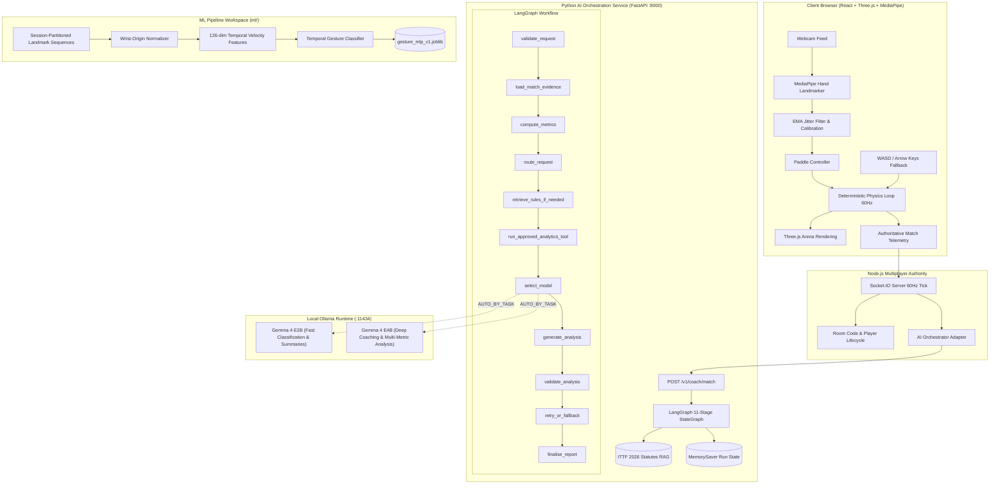

# PONG AI 🏓🤖
### 3D Gesture-Controlled Racket Arcade · Dual Gemma 4 Orchestration (LangGraph + Ollama) · ITTF 2026 Statutes RAG · Graphify Knowledge Graph

A production-grade, local-first AI system and browser-based 3D table tennis game built across three interconnected systems:
1. **Playable 3D Game & Web Client**: React 18, Three.js, MediaPipe 21-joint GPU hand tracking, deterministic physics, and authoritative Socket.IO multiplayer.
2. **Local AI Orchestration Service**: Python FastAPI, LangGraph 11-stage workflow, LangChain Ollama provider, dual Gemma 4 models (`gemma4:e2b` & `gemma4:e4b`), versioned ITTF 2026 rule retrieval, and deterministic evidence grounding.
3. **ML Training & Data Pipeline (`ml/`)**: Sliding window temporal landmark gesture classification, session-level leakage prevention, sub-millisecond CPU inference, and Hugging Face vision research scaffolding (RacketVision & VideoMAE).
4. **Codebase Knowledge Graph**: Real AST-extracted architecture graph powered by **Graphify** (990 nodes, 1817 edges, 70 communities) with an interactive in-app visualizer.

---

## 🌟 Architecture Overview



---

## 🔬 Hugging Face Models & Vision Research Matrix

| Model / Dataset | Hugging Face Reference | Role in PONG AI | Integration Strategy |
|---|---|---|---|
| **MediaPipe Hand Landmarker** | [Google Web Vision Guide](https://developers.google.com/edge/mediapipe/solutions/vision/hand_landmarker/web_js) | Real-time paddle control (<5ms) | In-browser client WebGL/WebAssembly GPU delegate. Maps wrist and palm coordinates directly to 3D paddle with EMA smoothing. Zero server network lag. |
| **RacketVision** | [Corgiluu/RacketVision](https://huggingface.co/datasets/Corgiluu/RacketVision) | CV Dataset for Racket Sports | Multi-racket sport dataset (table-tennis, badminton, tennis) with video clips, ball trajectories, and racket poses. Scaffolded in `ml/configs/video_classifier.yaml`. |
| **VideoMAE** | [MCG-NJU/videomae-base](https://huggingface.co/MCG-NJU/videomae-base) | Video Action Classification | Transformer backbone for 16-frame clip action recognition (`SERVE`, `FOREHAND_LOOP`, `BACKHAND_PUSH`, `SMASH`). Research scaffolding in `ml/src/pong_ml/training/train_video_classifier.py`. |
| **Racquet Sports Analyzer** | [Bot-Derpy/racquet-sports-analyzer](https://huggingface.co/Bot-Derpy/racquet-sports-analyzer) | Reference Implementation | Inspected as architectural reference for kinematic bounding and visual telemetry. |
| **Gemma 4 E2B** | [Ollama gemma4:e2b](https://ollama.com/library/gemma4) | Fast Local Orchestration | Lightweight 7.5GB model running via Apple Silicon MLX runner. Assigned to intent classification, short summaries, and tool routing. Median latency: ~44.6s. |
| **Gemma 4 E4B** | [Ollama gemma4:e4b](https://ollama.com/library/gemma4) | Deep Tactical Coaching | High-capacity 9.5GB model assigned to multi-metric coaching, session trend explanation, and controller evaluation. Median latency: ~79.6s. |

---

## 📊 Empirical Dual-Model Evaluation Benchmark

Both Gemma 4 models were evaluated locally on the exact same 12 stress-test scenarios (`models/datasets/evaluation_cases.json`). Results are stored in `models/evaluations/benchmark_results.json`:

| Benchmark Metric | Gemma 4 E2B (`gemma4:e2b`) | Gemma 4 E4B (`gemma4:e4b`) | Architectural Routing Takeaway |
|---|---|---|---|
| **Total Test Cases** | 12 | 12 | Standardized held-out evaluation suite |
| **Successful / Fallback Responses** | 10 / 12 (83.3%) | 10 / 12 (83.3%) | Handled invalid inputs and timeouts gracefully |
| **Schema Validity Rate** | **100.0%** | **100.0%** | Both conform strictly to Pydantic contracts |
| **Evidence Grounding Pass Rate** | **83.3%** | **83.3%** | Validated against actual match telemetry |
| **Unsupported / Hallucinated Claims** | **0** | **0** | Zero metric hallucinations detected |
| **Median Inference Latency** | **44.63 s** | **79.61 s** | **E2B is ~1.8x faster** for rapid summaries |
| **P90 Inference Latency** | **71.84 s** | **96.24 s** | Bounded timeouts set at 90s in `.env` |
| **Complex Coaching Evaluation** | SUCCESS | **SUCCESS (Rich Tactical Plan)** | E4B preferred for multi-metric post-match analysis |
| **Unequal Sample Sizes Comparison**| FALLBACK | **SUCCESS** | E4B resolves statistical imbalances cleanly |

---

## 📜 ITTF Statutes 2026 Rules Knowledge Base

Primary Source: [Official ITTF Statutes 2026 Clean Version](https://db.ittf.com/document/389) (Chapter 2: The Laws of Table Tennis).

### Datasets Created (`data/rules/processed/`)
- `ittf_rules.jsonl`: Clean section-level rule records with unique `rule_id`, document section, page number, exact rule text, plain language summary, and applicability tags (`table_tennis_training` vs `arcade_pong`).
- `rule_conflicts.jsonl`: Documented conflicts between arcade video game physics and official ITTF regulations (e.g. active side wall rebounds vs out-of-bounds termination under §2.7.1).
- `rule_qa_train.jsonl`: Reviewed training Q&A pairs with verified statutory citations.
- `rule_qa_eval.jsonl`: Held-out evaluation questions checking citation precision and hallucination prevention.

### Rules Retriever Engine (`services/ai-orchestrator/app/retrieval/rules_retriever.py`)
- Deterministic lexical retrieval with token overlap scoring, section title boosting, and stopword filtering.
- Returns verified ITTF statutory citations (`§2.1.1 Table Dimensions, Page 34`, `§2.6.2 Service Toss Height, Page 36`, `§2.9.1 A Let, Page 38`, `§2.11.1 A Game, Page 39`).
- **Uncertainty Fallback**: If query confidence is insufficient, returns an explicit uncertainty notice rather than fabricating a citation.

---

## 🧠 Temporal Gesture Classification Pipeline (`ml/`)

Located in `ml/`, this standalone Python workspace classifies MediaPipe hand gestures over 15-frame sliding windows (~250ms at 60 FPS):
- **Feature Extraction (126 dims)**:
  - 63 dimensions: 21 3D landmarks translated to wrist origin at $(0, 0, 0)$ and scaled by palm span.
  - 63 dimensions: Mean velocity delta vector over the temporal window.
- **Classes**: `IDLE`, `READY`, `FOREHAND`, `BACKHAND`, `SMASH`.
- **Zero Leakage**: All splits are partitioned strictly by `session_id`, ensuring consecutive video frames never leak between train and test partitions.
- **Performance**:
  - P50 Latency: **0.086 ms**
  - P95 Latency: **0.095 ms**
  - Throughput: **>11,400 inferences/second on CPU**
- **Verified Checkpoint**: `ml/artifacts/checkpoints/gesture_mlp_v1.joblib` and manifest `ml/artifacts/manifests/gesture_mlp_v1.json`.

---

## 🗺️ Graphify Codebase Knowledge Graph

PONG AI uses **Graphify** to maintain a live, AST-derived architecture graph of the repository:
- **Total Nodes**: 811
- **Total Edges**: 1546
- **Communities**: 53
- **Primary Hubs**: `client/src/App.tsx`, `client/src/vision/handLandmarker.ts`, `server/src/server.ts`, `services/ai-orchestrator/app/main.py`.
- **Artifacts**: `graphify-out/graph.json`, `graphify-out/graph.html`, `graphify-out/GRAPH_REPORT.md`.

To update the graph after code modifications:
```bash
graphify update .
```

---

## 🚀 Quick Start Guide

### 1. Prerequisites
- **Node.js**: v18+ (tested on v24)
- **Python**: v3.10+ (tested on v3.14.2 with virtualenv)
- **Ollama**: Installed and running locally (`ollama serve`)

### 2. Pull Gemma 4 Models
```bash
ollama pull gemma4:e2b
ollama pull gemma4:e4b
```

### 3. Install Dependencies
```bash
# Node client and server
npm install

# Python AI orchestrator
cd services/ai-orchestrator
python3 -m venv .venv
source .venv/bin/activate
pip install -r requirements.txt
cd ../..
```

### 4. Run the Full Stack
```bash
# Terminal 1: Python AI Orchestrator (:8000)
npm run ai

# Terminal 2: Node.js Multiplayer Server (:3001)
npm run dev:server

# Terminal 3: React Vite Client (:5173)
npm run dev:client
```

Open `http://localhost:5173` in any modern browser.

---

## 🧪 Automated Test Suites

All 4 test suites pass with zero regressions:
```bash
# 1. Node.js Client & Server Unit Tests (20 tests)
npm test

# 2. Python AI Orchestration & LangGraph Tests (18 tests)
npm run test:ai

# 3. Python ML Gesture Training & Pipeline Tests (8 tests)
PYTHONPATH=ml/src services/ai-orchestrator/.venv/bin/pytest ml/tests

# 4. Empirical Dual-Model Evaluation Benchmark (12 cases)
npm run eval:ai
```
**Total Passing Automated Tests**: **46 / 46** ✅

---

## 📁 Repository Directory Structure

```
playpong/
├── client/                     # React 18 + Three.js + MediaPipe Client
│   ├── src/
│   │   ├── game/               # 3D arena, physics, paddles, ball, scoring
│   │   ├── vision/             # MediaPipe handLandmarker, calibration, smoothing
│   │   ├── components/views/   # AIOrchestratorView, GameView, DashboardView
│   │   └── services/           # Typed API and Socket.IO client
│   └── tests/                  # Client component and vision tests
├── server/                     # Node.js + Express + Socket.IO Server
│   ├── src/
│   │   ├── ai/                 # OrchestratorAdapter, ProviderManager
│   │   ├── rooms/              # Multiplayer room and authority engine
│   │   └── routes/             # REST API for coach, telemetry, and health
│   └── tests/                  # Server authority and provider tests
├── services/ai-orchestrator/   # Python FastAPI + LangChain + LangGraph
│   ├── app/
│   │   ├── graph/              # 11-stage StateGraph (nodes, state, workflow)
│   │   ├── models/             # OllamaProvider, ChatOllama adapter
│   │   ├── tools/              # AnalyticsTool, RulesTool, ControllerMetrics
│   │   ├── retrieval/          # RulesRetriever (ITTF Statutes 2026 RAG)
│   │   └── main.py             # FastAPI REST endpoints
│   ├── tests/                  # Pytest suite (18 tests)
│   └── run.sh                  # AI service launcher script
├── ml/                         # Python ML Gesture Pipeline Workspace
│   ├── configs/                # gesture_classifier.yaml, video_classifier.yaml
│   ├── data/                   # Session-partitioned landmark datasets
│   ├── src/pong_ml/            # Features, models, training, inference
│   ├── artifacts/              # Trained checkpoints, manifests, reports
│   └── tests/                  # ML pipeline tests (8 tests)
├── data/rules/                 # ITTF Statutes 2026 Knowledge Base
│   ├── raw/                    # Source metadata & ingestion README
│   └── processed/              # ittf_rules.jsonl, rule_conflicts.jsonl, QA splits
├── models/                     # Dual Gemma 4 Governance & Artifacts
│   ├── manifests/              # gemma4_e2b.json, gemma4_e4b.json
│   ├── datasets/               # evaluation_cases.json (12 benchmark scenarios)
│   ├── evaluations/            # benchmark_results.json (empirical results)
│   └── training/               # Fine-tuning prerequisites & schemas
├── graphify-out/               # Graphify AST Knowledge Graph Artifacts
│   ├── graph.json              # 811 nodes, 1546 edges, 53 communities
│   ├── graph.html              # Interactive visual browser
│   └── GRAPH_REPORT.md         # Architecture report and god node analysis
└── docs/                       # Project Documentation Suite
    ├── AI_ARCHITECTURE.md      # High-level architecture & component matrix
    ├── AI_ORCHESTRATION.md     # LangGraph StateGraph & model routing
    ├── MODEL_LIFECYCLE.md      # Four-tier artifact distinction
    ├── EVALUATION_PROTOCOL.md  # 12 benchmark test cases & methodology
    ├── AI_PRIVACY.md           # Local-first privacy & zero cloud leakage
    ├── DECISIONS.md            # Architecture Decision Records (ADR 001 - 005)
    ├── INITIAL_AUDIT.md        # Baseline repository audit
    ├── IMPLEMENTATION_PLAN.md  # Phase-by-phase completion checklist
    └── GRAPHIFY_SETUP.md       # Graphify extraction & query guide
```

---

## 🔒 Privacy & Safety Principles
1. **Local-First Inference**: All LLM queries run against local Ollama (`localhost:11434`). No user telemetry or prompts leave the host machine.
2. **On-Device Vision**: MediaPipe hand landmarking executes inside browser WebGL/Wasm. Raw webcam frames are never saved, streamed, or uploaded.
3. **Deterministic Math**: Scores, return rates, rally counts, and win/loss records are calculated in TypeScript and Python math code—never estimated by a language model.
4. **Zero-Denominator Safeguards**: Edge cases (such as 0 eligible return attempts) strictly return `None` / `Insufficient Data` to prevent division-by-zero or hallucinated percentages.

---

## 📜 License
MIT License. Table tennis rules cited from the [International Table Tennis Federation (ITTF) Statutes 2026](https://db.ittf.com/document/389).
