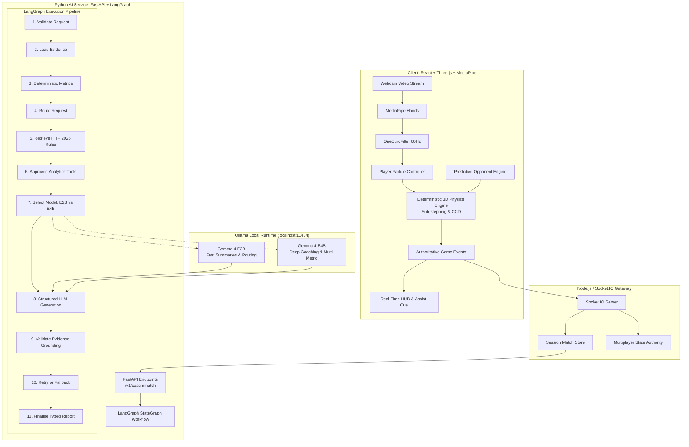

# PONG AI — Complete System & AI Architecture

## 1. Executive Summary

**PONG AI** is a local-first, vision-controlled 3D table tennis application integrating high-frequency real-time physics with multi-step local AI orchestration.

A foundational architectural invariant governs the system:
> **The language model is the intelligence and reflective coaching layer, never the physics or frame-by-frame collision loop.**

Putting a language model, network API call, or multi-step agent graph inside the 60/120 FPS animation and physics loop would introduce unacceptable jitter, add latency, and make table-tennis mechanics non-deterministic. Instead, gameplay execution and AI orchestration operate on distinct, decoupled lifecycles.

---

## 2. Component Responsibility Matrix

| Component | Technology | Primary Responsibility | Execution Cadence |
| :--- | :--- | :--- | :--- |
| **MediaPipe Pipeline** | `@mediapipe/tasks-vision` | Landmark detection, gesture classification (`READY`, `SWING`, `PALM`). | Per-frame (~30-60 Hz) |
| **OneEuroFilter** | TypeScript (Local math) | Smoothing noisy coordinates while preserving instantaneous strike responsiveness. | Per-frame (~60 Hz) |
| **Game Physics Engine** | TypeScript + Three.js | Continuous collision detection (CCD), net clipping, table bounce restitution (0.88), ball drag. | 120 Hz fixed substeps |
| **Predictive Opponent** | TypeScript | Solves trajectory intersection at opponent paddle plane ($z = +1.37\text{m}$), tracks target. | 60 Hz |
| **Deterministic Analytics** | Shared TS / Python | Computes return rates, denominator checks, rally lengths, reaction times, table heatmaps. | On match completion |
| **Node.js Gateway** | Node.js + Express + Socket.IO | Room coordination, multiplayer state authority, caching match statistics. | Real-time events |
| **AI Orchestrator** | Python 3 + FastAPI | LangGraph workflow execution, typed request contracts, error handling, checkpointer. | Asynchronous request |
| **LangGraph Engine** | `langgraph` StateGraph | 11-stage stateful workflow: validation, rules lookup, model selection, evidence checks, retries. | Sub-second pipeline |
| **Gemma 4 E2B** | Ollama local MLX/NVFP4 | Lightweight inference (7.5 GB, 128K context): intent routing, concise match summaries. | Fast (~1-3s) |
| **Gemma 4 E4B** | Ollama local MLX/NVFP4 | Deep reasoning (9.5 GB, 128K context): tactical coaching, biomechanical recommendations. | Thorough (~3-8s) |
| **Rules Registry** | Versioned Python & TS | Authoritative ITTF 2026 Table Tennis Statutes & Arcade Pong rule specifications. | Direct in-memory lookup |

---

## 3. Separation of Concerns & Safety Invariants

1. **Deterministic Authority**:
   - Scores and rally outcomes are calculated **solely** by the game engine finite state machine (`READY` -> `SERVE` -> `RALLY` -> `POINT_END`).
   - The AI language model is strictly prohibited from altering match scores or deciding point winners.
2. **Local Inference Independence**:
   - If Ollama is offline or Gemma models are unavailable, the game **never crashes**.
   - The AI service seamlessly falls back to the deterministic, rule-grounded coaching generator (`status="FALLBACK"`).
3. **Evidence Grounding**:
   - Model claims are verified against the deterministic telemetry before returning to the dashboard.
   - If a metric denominator is zero (e.g. 0 return attempts), the model is prohibited from asserting a 100% or 0% return rate.
