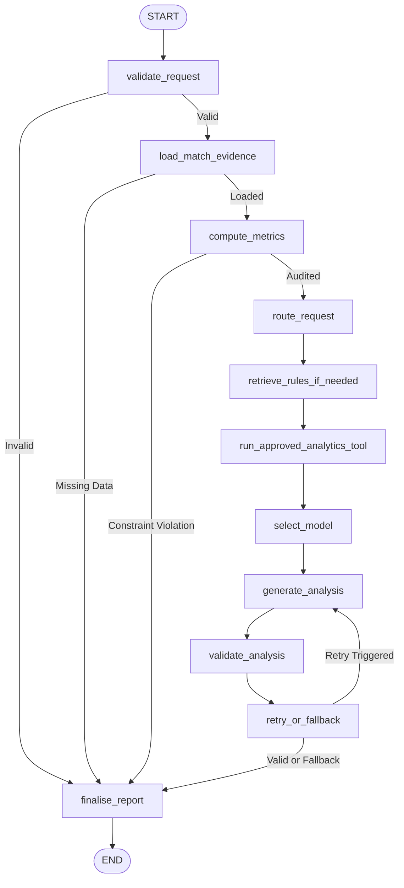

# PONG AI — Local AI Orchestration System

## 1. Overview

The **PONG AI Orchestrator** is a dedicated Python service (`services/ai-orchestrator/`) combining **LangChain**, **LangGraph**, and **Ollama** to deliver evidence-grounded performance coaching, natural-language telemetry querying, and rules explanation.

The orchestrator operates as an out-of-band analytical intelligence layer. It receives match summaries produced by the game engine, applies deterministic mathematical checks, queries versioned ITTF 2026 rules, routes to the appropriate Gemma 4 model variant, and validates model output against hard data before responding.

---

## 2. Dual Gemma 4 Strategy & Model Routing

| Model | Size | Parameter Tier | Role in PONG AI |
| :--- | :--- | :--- | :--- |
| **Gemma 4 E2B** (`gemma4:e2b`) | ~7.5 GB | Effective 2B | Fast classification, intent routing, concise match summaries, quick tactical advice. |
| **Gemma 4 E4B** (`gemma4:e4b`) | ~9.5 GB | Effective 4B | Deep multi-metric post-match analysis, personalized training drill generation, benchmark interpretation. |

### Configurable Model Routing Policies
Configured via `MODEL_ROUTING_POLICY` in `.env`:
- `AUTO_BY_TASK` *(Default)*: Routes lightweight tasks (`FAST_SUMMARY`, `INTENT_ROUTING`, `RULE_EXPLANATION`) to E2B; routes deep tasks (`MATCH_COACHING`, `ANALYTICS_EXPLANATION`, `BENCHMARK_INTERPRETATION`) to E4B. If E4B is not loaded or downloading, automatically falls back to E2B.
- `E2B_ONLY`: Forces all tasks to Gemma 4 E2B to conserve system RAM on constrained machines (8GB).
- `E4B_ONLY`: Dedicated to deeper reasoning on higher-memory machines (16GB+).
- `ON_DEMAND`: Selects whichever model is currently warm in Ollama memory.

---

## 3. LangGraph Workflow Pipeline

The orchestration workflow is executed via a compiled LangGraph `StateGraph`:

### Detailed Node Specifications

1. **`validate_request`**: Checks request schema, verifies `match_id` is present, validates `request_type`. Rejects invalid payloads with HTTP 400.
2. **`load_match_evidence`**: Ingests authoritative match stats (`playerScore`, `opponentScore`, returns, rallies, zone distribution).
3. **`compute_metrics`**: Deterministic Python auditing:
   - Validates return success rate: $\text{Rate} = \frac{\text{successful}}{\text{eligible}} \times 100$
   - Handles zero denominator: If $\text{eligible} = 0$, returns `None` and flags `has_zero_attempts = True`.
   - Checks sanity: Flags constraint violations if $\text{successful} > \text{eligible}$.
4. **`route_request`**: Classifies request intent into coaching, analytics Q&A, or rules exploration.
5. **`retrieve_rules_if_needed`**: Direct retrieval from `RULE_REGISTRY` (ITTF 2026 Statutes §2.1–§2.11 and Arcade Pong specs).
6. **`run_approved_analytics_tool`**: Read-only tools calculating spatial court dominance (Center, Left Corner, Right Corner) and session history deltas.
7. **`select_model`**: Resolves model tag (`gemma4:e2b` vs `gemma4:e4b`) based on task type and local model availability.
8. **`generate_analysis`**: Invokes LangChain `ChatOllama` with structured JSON system prompt and telemetry context.
9. **`validate_analysis`**:
   - Parses JSON structure.
   - Verifies that cited metric values match validated telemetry.
   - Prohibits claiming return percentages when attempts are zero.
   - Validates cited rule IDs against `RULE_REGISTRY`.
10. **`retry_or_fallback`**:
    - If validation errors exist and `retry_count < AI_MAX_RETRIES`, re-prompts the model with error guidance.
    - If errors persist or model is offline, generates the deterministic, rule-grounded fallback report.
11. **`finalise_report`**: Attaches execution metadata, provider info, and inference latency before returning.

---

## 4. Run State & Persistence

Each workflow run is registered in LangGraph's local memory checkpointer (`MemorySaver`) under a unique `thread_id` (`run_<uuid>`). The frontend or monitoring tools can inspect intermediate node states and verification logs via `GET /v1/runs/{run_id}`.
